<p align="center"></p>

# pve-gateway

A small web UI that turns a Proxmox VE host into the gateway for its VMs and containers:

- **Ports:** forward host ports to guests (iptables DNAT).
- **Domains:** route `app.example.com` → guest `ip:port` through nginx, with automatic Let's Encrypt and wildcard (`*.example.com`) certificates.

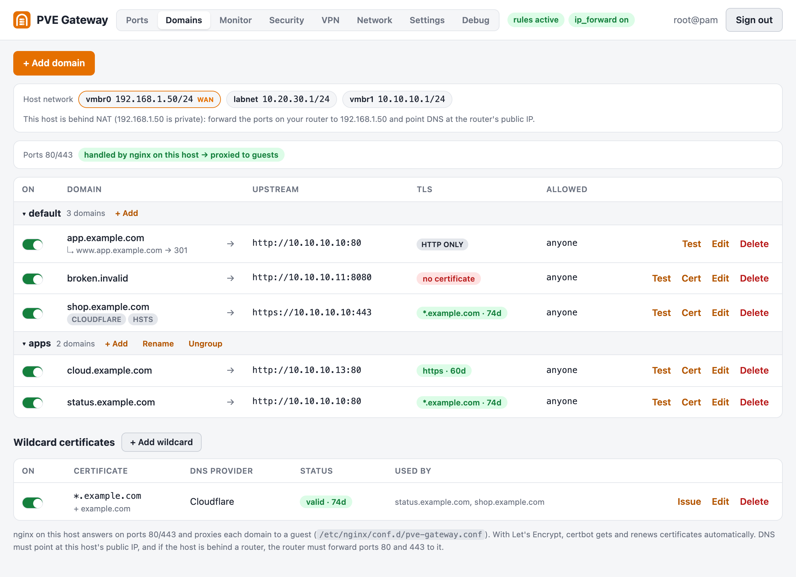

## Screenshots

| | |
|---|---|
| 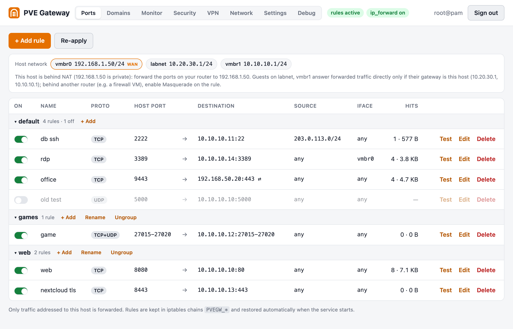 | 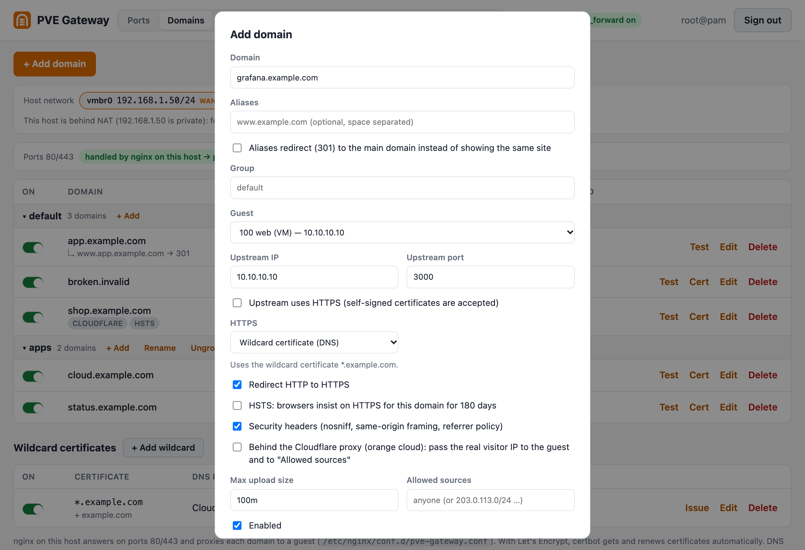 |
| **Ports**: forward host ports to guests, with source/interface filters and live hit counters | **Add domain**: pick a guest, choose Let's Encrypt, a wildcard certificate or plain HTTP |
| 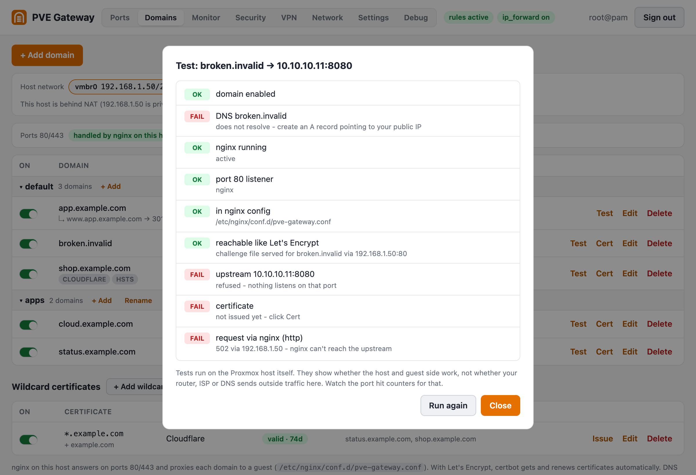 | 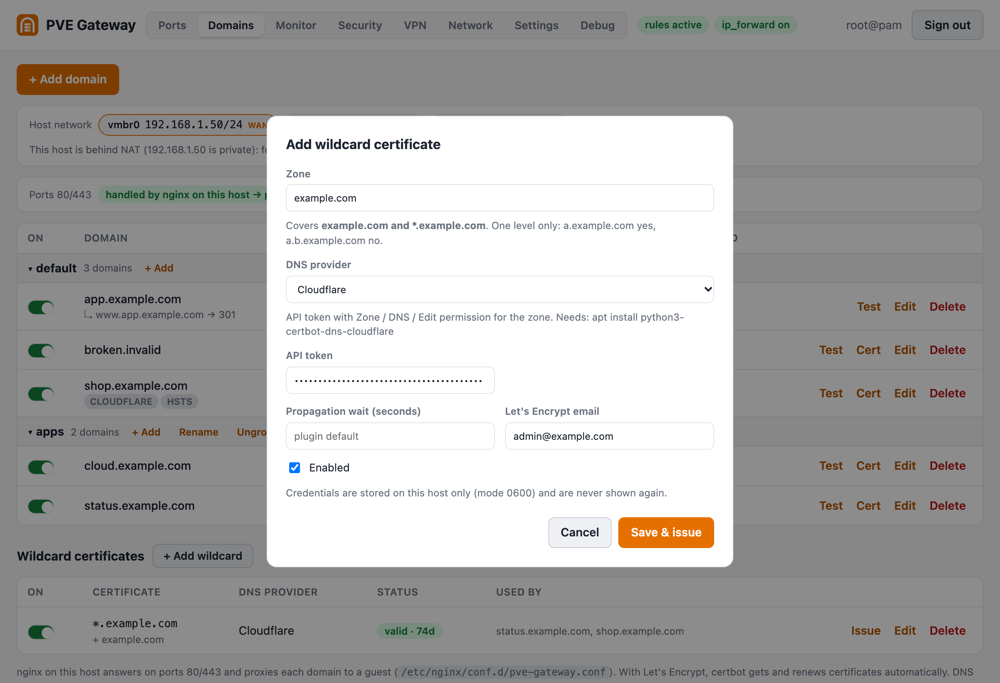 |
| **Test**: checks DNS, nginx, the upstream, the certificate and a real request, with how to fix each failure | **Wildcard certificates**: `*.example.com` through your DNS provider's API ([guide](wildcard.md)) |
| 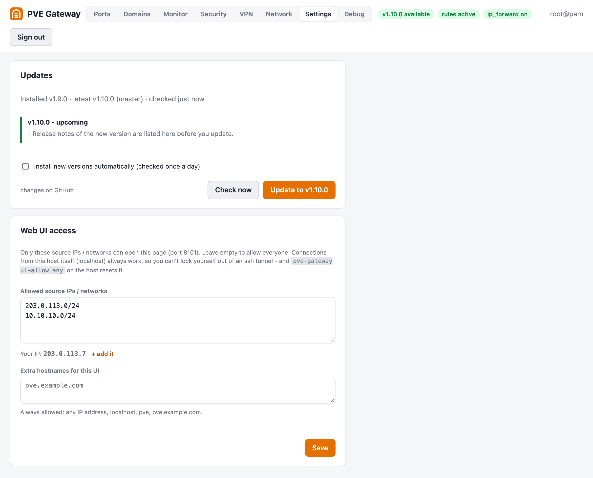 | 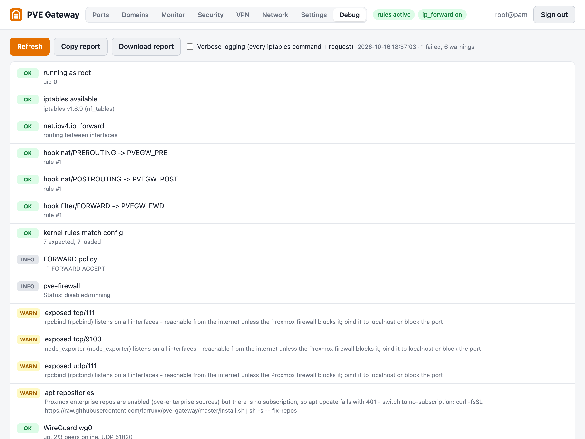 |
| **Settings**: only the IPs/networks you list can reach the web UI | **Debug**: health checks, raw iptables/nginx/certbot output, log and a downloadable report |
| 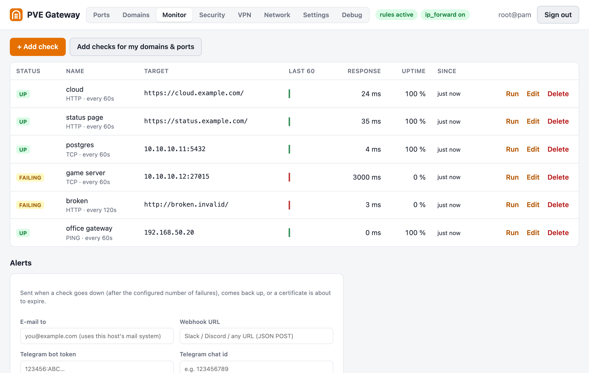 | 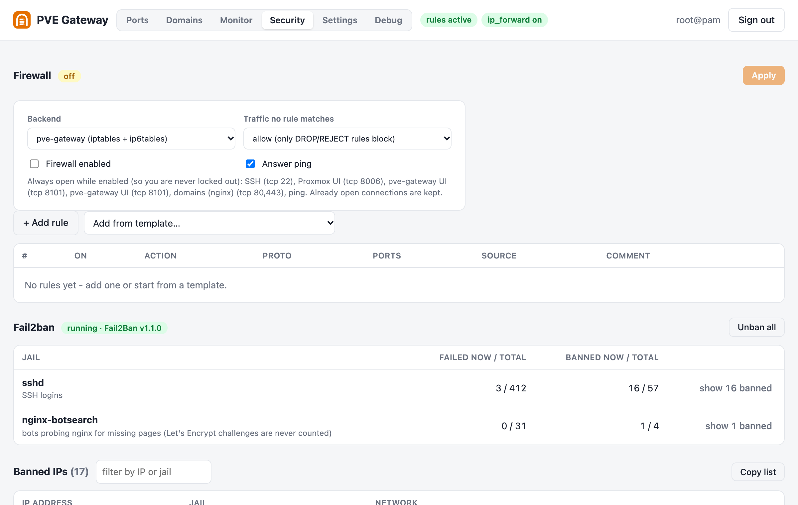 |
| **Monitor**: health checks with uptime and history, alerts (e-mail, webhook, Telegram), port scanner | **Security**: firewall (own iptables or Proxmox firewall), fail2ban jails and banned IPs |
| 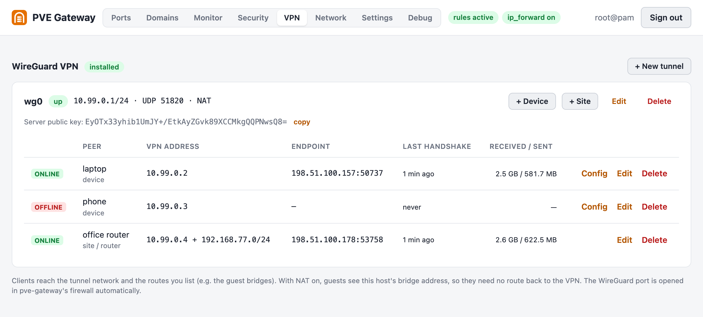 | 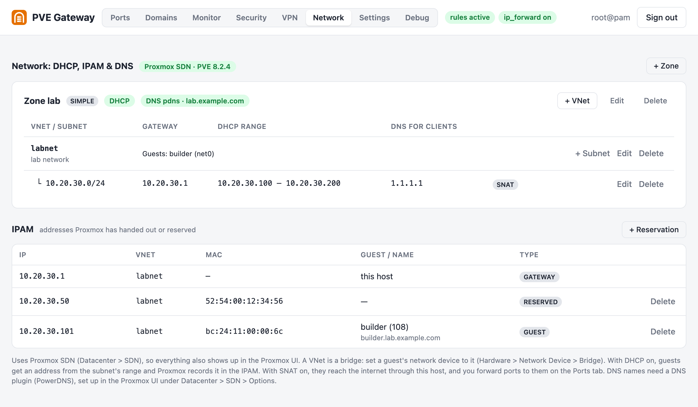 |
| **VPN**: WireGuard tunnel, devices with downloadable configs, sites, live status | **Network**: Proxmox SDN zones and VNets, subnets with DHCP, IPAM reservations, DNS |

<sub>Screenshots use sample data from the built-in mock mode (`./dev.sh`). Regenerate them with `dev/screenshots.sh`.</sub>

- **No dependencies.** It's one Python 3 file using only the standard library, and it drives `iptables`. Both already ship with Proxmox VE 7 and 8.
- **Login with your Proxmox account.** Credentials are checked against the local PVE API, and only `root@pam` is allowed by default. You can switch to a local password instead.
- **HTTPS out of the box.** It reuses the Proxmox certificate (`/etc/pve/local/pveproxy-ssl.*` or `pve-ssl.*`).
- **Safe to run next to other rules.** Everything lives in its own chains (`PVEGW_PRE`, `PVEGW_POST`, `PVEGW_FWD`), which are swapped atomically with `iptables-restore`. pve-firewall and your own rules are left alone.
- **Guest picker.** It lists local VMs and CTs with their IPs (from the QEMU guest agent, the host's ARP table, cloud-init or the LXC config; see [Guest IPs](#guest-ips)).
- **Host network at a glance.** The Ports and Domains tabs show the host's interfaces and IPs (public, WAN, guest bridges) with tips on where DNS and routers should point.
- Supports TCP, UDP or both, port ranges, a source IP/CIDR allow-list, an incoming interface, optional masquerade, and shows per-rule hit counters.
- **Groups.** Port rules and domains can be put into groups (e.g. *web*, *games*). Each group is a collapsible section with its own **+ Add**, **Rename** and **Ungroup**. Anything without a group, including everything saved by older versions, stays in **default**. While all items are in default, the tables look as before. Groups only change how items are listed; they don't affect iptables or nginx.
- **Guard rails.** It refuses to forward 22, 8006, 3128, 111, 5405-5412 or its own port. Only traffic **addressed to the host** is forwarded (`-m addrtype --dst-type LOCAL`), so guests' outgoing traffic is never hijacked.
- A watchdog re-hooks the chains if something flushes iptables, and rules are restored at boot.

## Install (on the Proxmox host, as root)

One command downloads, installs and starts the service:

```bash
curl -fsSL https://raw.githubusercontent.com/farruxx/pve-gateway/master/install.sh | sh
```

Then open `https://<proxmox-ip>:8099` and log in as `root@pam`.

To use the **Domains** tab (reverse proxy by hostname), add nginx and certbot. They are the only optional dependencies, both from Debian:

```bash
curl -fsSL https://raw.githubusercontent.com/farruxx/pve-gateway/master/install.sh | sh -s -- --with-nginx
```

For **wildcard certificates**, also add your DNS provider's certbot plugin, for example Cloudflare (see [wildcard.md](wildcard.md)):

```bash
curl -fsSL https://raw.githubusercontent.com/farruxx/pve-gateway/master/install.sh | sh -s -- --with-dns cloudflare
```

**Updating:** in **Settings → Updates**, click **Update to vX.Y.Z**, or tick *Install new versions automatically*. pve-gateway checks GitHub once a day and shows a badge in the header when a new version is out, together with what changed (from [CHANGELOG.md](CHANGELOG.md)). From a shell, run `pve-gateway update`, or re-run the install command. Your rules, domains and certificates are kept either way.

- **No Proxmox subscription?** That's the normal case and it's handled for you. Without a subscription, the Proxmox *enterprise* repositories answer `401 Unauthorized`. When the installer sees that, it switches apt to the free **no-subscription** repositories:
  - the enterprise entries (pve and ceph) are disabled, not deleted;
  - the matching no-subscription entries are added, for the same Debian release;
  - a backup of the old files goes to `/var/lib/pve-gateway/apt-backup/`.

  Works on PVE 8 (`.list`) and PVE 9 (`.sources`). It's safe while VMs are running; nothing is upgraded or restarted. Hosts with a working subscription are left alone. Use `--keep-repos` to skip the switch, or run only the switch:

  ```bash
  curl -fsSL https://raw.githubusercontent.com/farruxx/pve-gateway/master/install.sh | sh -s -- fix-repos
  ```
- **Prefer to read before you run?** Clone the repo and run the script from it; it then uses the local files instead of downloading:

  ```bash
  git clone https://github.com/farruxx/pve-gateway && cd pve-gateway && sh install.sh --with-nginx
  ```

### Guest IPs

The guest picker fills in a VM's IP from the **QEMU guest agent** if one is running. Without the agent it falls back to the host's **ARP table**, matching the VM's MAC address, then to the **SDN IPAM** (guests on a DHCP VNet, see [Network](#network-dhcp-ipam-and-dns-proxmox-sdn)), and then to a **cloud-init** `ipconfig`.

A VM whose gateway is another router (for example a firewall VM) never talks to the host itself, so it isn't in the ARP table. For those, the picker briefly probes the addresses on the host's private bridges, at most every 5 minutes and never the uplink, so they answer ARP and show up. For containers, the IP comes from LXC or the container config. If a VM still shows *IP unknown*:
- install the agent in the VM (`apt install qemu-guest-agent`),
- turn on **Options → QEMU Guest Agent** for the VM in Proxmox, and restart the VM.

You can always type the IP by hand.

## Domains (nginx reverse proxy)

The **Domains** tab maps hostnames to guests: `cloud.example.com` → `10.10.10.13:80`, `git.example.com` → `https://10.10.10.10:443`, and so on. nginx on the host answers on ports 80 and 443 and proxies each request by its `Host` header, so many guests can share one public IP and the same ports.

- Everything goes into a single generated file, `/etc/nginx/conf.d/pve-gateway.conf`. Other nginx sites are left alone. Each change is checked with `nginx -t` before reload; if the check fails, the previous file is restored and the error is shown in the UI.
- **Let's Encrypt** (optional, per domain) uses `certbot certonly --webroot`. The certificate is requested in the background right after saving, and certbot's own systemd timer renews it, reloading nginx through a deploy hook. *Cert* re-requests it on demand, and *Test* checks DNS, nginx, the upstream, the certificate and a real request through nginx.
- **Per domain options:**
  - aliases (extra hostnames), served as the same site or **redirected with a 301** to the main domain;
  - an HTTPS upstream (self-signed certificates are accepted);
  - redirect HTTP to HTTPS, and optional **HSTS**;
  - **security headers** (nosniff, same-origin framing, referrer policy);
  - max upload size, and allowed source IPs/CIDRs;
  - **Behind Cloudflare**: for domains behind the orange cloud, nginx trusts Cloudflare's address ranges, so logs, the guest and *Allowed sources* see the real visitor IP.

  WebSockets always work.
- **Test** checks DNS (A, AAAA and Cloudflare-proxied records), nginx and the upstream. It also checks the certificate nginx **actually serves**: it must cover every name, not be close to expiry, and be the same over IPv4 and IPv6. Aliases set to redirect must answer with a 301.
- **Requirements:** each domain's DNS A record must point to the host's public IP. If the host sits behind a router, the router has to forward TCP 80 and 443 to it.
- While any domain is enabled, port-forward rules can't take TCP 80 or 443, because those ports belong to nginx. The reverse is enforced too.

### Wildcard certificates (`*.example.com`)

> Step-by-step setup (DNS records, API tokens, troubleshooting): see [wildcard.md](wildcard.md).

One certificate covers `example.com` and every `*.example.com` subdomain. Let's Encrypt only issues wildcards through a **DNS-01** check, so certbot creates a TXT record through your DNS provider's API. Port 80 doesn't have to be reachable for this.

1. Install the certbot plugin for your provider (they're all Debian packages):

   ```bash
   apt install python3-certbot-dns-cloudflare
   ```

2. Go to **Domains → Wildcard certificates → + Add wildcard** and enter the zone (`example.com`), the provider and the API token. It is issued right away (~30 s).
3. For each domain, choose **HTTPS: Wildcard certificate (DNS)**. The matching certificate is picked automatically, so a new subdomain is on HTTPS immediately.

| Provider | Package | Credentials |
|---|---|---|
| Cloudflare | `python3-certbot-dns-cloudflare` | API token with *Zone / DNS / Edit* |
| DigitalOcean | `python3-certbot-dns-digitalocean` | API token |
| Linode / Akamai | `python3-certbot-dns-linode` | API token |
| DNSimple | `python3-certbot-dns-dnsimple` | API token |
| OVH | `python3-certbot-dns-ovh` | endpoint + application key/secret + consumer key |
| RFC 2136 (BIND, PowerDNS, Knot) | `python3-certbot-dns-rfc2136` | server, TSIG key name/secret/algorithm |

- **Coverage:** a wildcard covers one level only. `*.example.com` matches `a.example.com` but not `a.b.example.com`; for that you'd add a wildcard for `b.example.com`.
- **Credentials** are written to `/etc/pve-gateway/dns/<id>.ini` (mode 0600, directory 0700). They're never returned by the API or included in the debug report. When editing, an empty field keeps the stored value.
- **Renewal:** certbot's timer renews wildcards through the same DNS plugin. A wildcard that domains still use can't be deleted or disabled.

## Typical setup

Guests sit on a private bridge (for example `vmbr1`, `10.10.10.0/24`), and the host does NAT for them. Add a rule like:

| Host port | Destination | Meaning |
|---|---|---|
| `8080` | `10.10.10.10:80` | `http://<host-ip>:8080` reaches VM 100's web server |
| `27015-27020` TCP+UDP | `10.10.10.12` | port range, same ports on the guest |

**Masquerade** is only needed if the guest's default gateway is *not* the Proxmox host, or if other guests need to reach the service through the host's public IP (hairpin NAT). Note that with masquerade on, the guest sees the host's IP instead of the real client IP.

## CLI

```
pve-gateway serve           # web UI (what systemd runs)
pve-gateway status          # rules, hit counters, hook status
pve-gateway test [NAME...]  # reachability test (rule id/name/host port or domain; default: all enabled)
pve-gateway ui-allow IP...  # web UI only from these IPs/networks ("any" = everyone, no args = show)
pve-gateway ui-host NAME..  # extra hostnames the web UI may be opened by ("none" = clear)
pve-gateway --version       # installed version
pve-gateway update [check]  # install the latest version from GitHub ("check" = only check)
pve-gateway monitors        # run every health check once
pve-gateway scan IP [PORTS] # TCP port scan from this host (common | 22,80,8000-8100)
pve-gateway domains         # list domains, wildcard certificates and expiry
pve-gateway cert NAME       # request / renew now: a domain, or '*.example.com' for a wildcard
pve-gateway debug           # full diagnostic report, paste it when asking for help
pve-gateway show            # print the generated iptables-restore payload
pve-gateway apply           # re-apply saved rules
pve-gateway flush           # remove all forwarding rules/chains (config kept)
pve-gateway passwd          # use a local user/password instead of Proxmox login
pve-gateway -v ...          # verbose: log every iptables command and HTTP request
pve-gateway --dry-run ...   # log iptables commands instead of running them (for testing)
```

## Debugging

**Debug tab** in the web UI:
- **Health checks:** root, iptables, `ip_forward`, whether each hook exists and where it sits in its chain, whether the kernel rules match the config, FORWARD policy, pve-firewall status, and host services listening on a forwarded port.
- **Raw output:** the generated ruleset, the loaded `PVEGW_*` rules with packet/byte counters, the full PREROUTING/POSTROUTING/FORWARD chains, tracked connections to the guests, interfaces, routes, listening sockets, and the config (password hash hidden).
- **Service log:** the last 500 lines kept in memory, plus a *Verbose logging* switch that takes effect immediately without a restart.
- **Copy report / Download report:** gives you the same text as `pve-gateway debug`.

**Test** button on each rule (or `pve-gateway test`): runs from the host and checks:
- the rule is loaded
- `ip_forward` is on
- the route to the guest (and whether it goes through a gateway)
- a ping to the guest
- a TCP connect to the guest port, which tells refused (nothing listening) apart from timeout (guest down or firewalled)
- the rule's hit counter

The tests check the guest side only. If the counter stays at 0 while you test from outside, traffic never reaches the host, so check your router, ISP or cloud firewall.

Service logs: `journalctl -u pve-gateway -f`. To keep verbose logging on permanently, change `ExecStart` in the unit to `... pve-gateway -v serve`.

## Local development (macOS)

`--mock` runs everything against a simulated Proxmox host. It needs no root, no iptables and no Proxmox. The mock fakes `iptables`, `iptables-restore`/`-save`, `ip`, `ping`, `ss`, `conntrack`, `pve-firewall`, `pvesh` (including SDN), `qm`, `pct`, `lxc-info`, `dnsmasq` and more. The mock code lives in [`dev/mock.py`](dev/mock.py) and is never installed on a host.

```bash
./dev.sh
```

Open http://127.0.0.1:8099 and log in as **admin / admin**.

You can run any CLI command against the same simulated host. The web UI and CLI share state through `.dev/mock-state.json`:

```bash
./dev.sh status
```
```bash
./dev.sh test
```
```bash
./dev.sh debug
```

To break the host on purpose, run a scenario. They're also available as buttons on the Debug tab:

```bash
./dev.sh mock unhook
```

| Scenario | What it does |
|---|---|
| `unhook` | removes our jump rules. The checks fail, and the watchdog repairs it within 10 s |
| `ip-forward-off` | sets `net.ipv4.ip_forward = 0` |
| `forward-drop` | sets the FORWARD policy to DROP |
| `pvefw-first` | moves pve-firewall's jump above ours (warning) |
| `foreign-dnat` | puts another DNAT rule above our hook (warning) |
| `traffic` | sends a burst of hits to the counters |
| `nginx-stopped` | stops nginx, so domain tests fail |
| `nginx-test-fails` | makes the next `nginx -t` fail, showing the rollback |
| `cert-expiring` | makes every certificate expire in 5 days |
| `no-dnsmasq` | dnsmasq is missing, so SDN DHCP can't work (Install button on the Network tab) |
| `no-sdn` | an old Proxmox VE (7.4) without the SDN API |
| `sdn-pending` | an SDN change made elsewhere that isn't applied yet |
| `reset` | wipes the simulated iptables |

The simulated guests are 100 web, 101 db, 102 game (stopped), 103 nextcloud, 104 win11 (no guest agent, ignores ping), 105 office-gw (behind a gateway) and 108 builder (on the SDN VNet `labnet`, found through the IPAM). The sample SDN has zone `lab` (DHCP, PowerDNS plugin), VNet `labnet` and subnet `10.20.30.0/24`. The sample rules show every test outcome. The sample domains are `cloud.example.com` (HTTPS working), `app.example.com` (HTTP only, with an alias) and `broken.invalid` (no DNS and nothing listening upstream). The sample wildcard is `*.example.com` (Cloudflare), used by `status.example.com`. The mock certbot fails for names ending in `.invalid` and succeeds after 2 s for everything else. For wildcards, the API token `bad` gets Cloudflare's "invalid credentials" error, and only the Cloudflare, DigitalOcean and RFC 2136 plugins count as installed, so OVH shows the "plugin missing" message. Generated nginx files end up under `.dev/mock-fs/`. Delete `.dev/` to start over.

`--dry-run` is different. It's meant for a **real** host: read-only commands run for real, and changes are only logged.

## Monitoring

The **Monitor** tab watches your guests and domains:

- **Health checks:** HTTP(S) (expected status, certificate expiry), TCP port, and ping, every N seconds. Each check shows up / failing / down, response time, uptime and the last 60 results. **Add checks for my domains & ports** creates one check per domain and port rule.
- **Alerts:** sent when a check is down for N checks in a row, when it comes back up, and when a certificate expires within N days. Channels:
  - **e-mail**, through the host's mail system (Proxmox ships postfix);
  - a **webhook** (Slack, Discord or any URL; JSON with `text`/`content`);
  - **Telegram** (bot token + chat id).

  **Send test alert** checks the setup. Tokens are stored on the host only and never shown again.
- **Port scanner:** a TCP connect scan from the host (about 90 common ports, or ranges up to 5000), with service names and risk levels. It shows what the host itself can reach; the internet's view can differ. To prevent misuse, only this host, private networks and known guests can be scanned.

CLI: `pve-gateway monitors` runs every check once; `pve-gateway scan 10.10.10.11 1-1024` scans from the shell.

## WireGuard VPN

The **VPN** tab sets up WireGuard on the host:
- **Tunnels:** a new tunnel comes pre-filled with sensible defaults: a free `10.99.x.0/24` subnet, UDP 51820, this host's public address as the endpoint, and the guest bridges as the networks clients can reach. Keys are generated on the host, and the tunnel starts now and at boot (`wg-quick@wg0`).
- **Devices** (phone, laptop): keys are generated for them, and you get the **client config** to import into the WireGuard app (view, copy or download).
- **Sites** (another router or office): paste its public key, plus the networks behind it, its endpoint and keepalive.
- **Peer details:** optional pre-shared keys, and live status per peer: online, last handshake, endpoint and traffic.

Peer changes are applied with `wg syncconf`, so connected clients stay connected. There are no free-form `PostUp` lines. NAT for VPN clients (*NAT to guest networks*) and forwarding are pve-gateway iptables rules, and the WireGuard port opens automatically in pve-gateway's firewall. Private keys stay in `/etc/pve-gateway/wireguard/` and `/etc/wireguard/` (mode 0600); they never appear in `config.json`, the API or the debug report.

## Network: DHCP, IPAM and DNS (Proxmox SDN)

The **Network** tab manages [Proxmox SDN](https://pve.proxmox.com/pve-docs/chapter-pvesdn.html) through the Proxmox API, so everything also shows up under *Datacenter → SDN* in the Proxmox UI. pve-gateway keeps no copy of it. It needs Proxmox VE 8.1 or newer.

- **Zones:** new zones are *simple* zones: isolated bridges on this host, with no VLAN setup needed. Each zone can hand out **DHCP** (Proxmox runs one dnsmasq per zone; the **Install dnsmasq** button installs it and turns off the default instance). The built-in Proxmox IPAM keeps track of addresses. VLAN, VXLAN and EVPN zones made in the Proxmox UI are listed but not edited.
- **VNets** become bridges named after the VNet. To connect a guest, set its network device's bridge to the VNet (*Hardware → Network Device → Bridge*). The tab shows which guests use which VNet, and refuses to delete a VNet that still has guests.
- **Subnets:** gateway (this host's address on the VNet), **SNAT** (guests reach the internet through the host), DHCP ranges and the DNS server handed to DHCP clients. Subnets that overlap host networks, other subnets or WireGuard tunnels are refused.
- **IPAM:** every address Proxmox handed out (with the guest and hostname) or reserved. **+ Reservation** pins an IP to a MAC address, and you can pick the guest's NIC instead of typing the MAC.
- **DNS:** pick a Proxmox SDN DNS plugin (PowerDNS) and a domain per zone, and Proxmox registers the guests' names. Add the plugin itself in the Proxmox UI (*Datacenter → SDN → Options*), so its API key stays in Proxmox; pve-gateway never reads or shows it.

Changes are pending in Proxmox until you click **Apply SDN changes**, the same as in the Proxmox UI. Apply reloads the SDN networks. When pve-gateway's firewall is on, DHCP (UDP 67) is allowed on the DHCP VNets only, never on the uplink. Guests that got their address from SDN DHCP are found through the IPAM in the guest picker, so you can forward ports to them on the Ports tab. The Debug tab checks dnsmasq, `source /etc/network/interfaces.d/*`, pending changes, VNet bridges and the per-zone DHCP servers.

## Firewall

**Security → Firewall** protects the host itself (incoming traffic). You choose the backend:
- **pve-gateway**: its own `PVEGW_IN` chain for iptables and ip6tables, hooked first in `INPUT`.
- **Proxmox firewall**: pve-gateway creates its rules (comment `pvegw: …`) at the top of the node's firewall through the Proxmox API, so they also show in the Proxmox UI. Your own Proxmox rules are left alone and listed underneath.

Rules are ordered **allow / drop / reject** entries:
- protocol TCP, UDP, ICMP or any;
- port lists and ranges;
- an optional source network;
- a comment.

The default policy is *allow everything else* or *drop everything else*. Templates add common sets (web, mail, DNS, WireGuard, SSH, Proxmox, databases from private networks only). **Risky ports open right now → LAN only** uses the exposure check to keep services like rpcbind or databases off the internet.

**You can't lock yourself out:**
- **Always open:** SSH, the Proxmox UI (8006), pve-gateway's own port (from its allowed sources), 80/443 while you have domains, the cluster ports on clusters, and established connections. A drop rule for *everyone* on 22/8006/the UI port is refused.
- **Every change is temporary at first:** you have **60 seconds to click Keep**. If the page can't reach the server any more, the previous firewall comes back by itself. Unconfirmed changes are never saved, so a restart also brings back the old rules.

## Fail2ban

The **Security** tab shows fail2ban's jails with failed and banned counts. All banned IPs are in one searchable list (IP, jail, and how many bans come from the same network), with **Copy list**. You can **unban** one IP or all of them, and **ban** an IP by hand (never your own IP or localhost). **Install fail2ban** sets it up if it's missing.

Tick *Let pve-gateway manage fail2ban* to configure it from the UI: ban time, find time, failures before a ban, a **never ban** list, and these jails:
- **sshd**: SSH logins.
- **proxmox**: failed logins to the Proxmox web UI (port 8006), read from `pvedaemon` in the journal.
- **pve-gateway**: failed logins to this UI.
- **nginx-botsearch**: bots probing for missing pages. Requests for `/.well-known/acme-challenge/` are never counted, so Let's Encrypt's validation servers can't get banned after a failed certificate attempt.
- **recidive**: banned again within a day → banned for a week.

pve-gateway writes `/etc/fail2ban/jail.d/pve-gateway.local` (read last, so it overrides `jail.local`) plus its own `pvegw-*` filters. Each change is checked with `fail2ban-client -t`, and the previous files are restored on failure. Unticking the option removes the file.

## Securing the web UI

The UI runs as root, can change the host's firewall and nginx, and logs in with `root@pam`. Don't leave it open to the internet:

- **Restrict who can connect:** go to **Settings → Web UI access** and list the IPs/networks allowed to open the page, e.g. your office IP or VPN range. Everyone else is refused before they can even reach the login form.
  - Connections from the host itself (`localhost`, e.g. through an ssh tunnel) always work.
  - The UI refuses a list that would lock out the IP you're saving it from.
  - From an ssh session: `pve-gateway ui-allow 203.0.113.7 10.20.0.0/24`, or `pve-gateway ui-allow any` to undo.
- **Login protection:**
  - After 5 failed logins an IP is blocked for 15 minutes.
  - Only one login per IP is checked at a time, so parallel guessing doesn't help.
  - Proxmox accounts with **two-factor (TOTP)** work: the login asks for the code.
- **Sessions** are tied to the IP and browser they were created from, so a copied cookie is useless elsewhere. Browsers don't separate cookies by port, so a guest service you open on the same host IP could otherwise see it.
- **Allowed Proxmox users:** only `root@pam` by default. Add more users in **Settings** (format `name@realm`).
- **Exposure check:** the Debug tab warns about risky services (rpcbind, databases, Redis, Docker API, VNC, …) listening on all interfaces, and about enterprise repositories enabled without a subscription.
- **Hostname check:** the UI only answers to IP addresses, this host's own names, and hostnames you add (Settings, or `pve-gateway ui-host pve.example.com`). This blocks DNS-rebinding attacks.

## Config: `/etc/pve-gateway/config.json`

Rules are stored here too. Restart the service after editing it by hand.

```json
{
  "listen": "0.0.0.0",
  "port": 8099,
  "allowed_users": ["root@pam"],
  "protected_ports": ["22", "8006", "3128", "111", "5405-5412"],
  "forward_accept": true
}
```

- `allowed_users`: Proxmox users allowed to log in. Accounts with TFA enabled aren't supported; use `passwd` instead.
- `forward_accept`: adds narrow `ACCEPT` rules in `FORWARD` for the forwarded flows. They're inserted before `PVEFW-FORWARD`, so if the Proxmox firewall is on for a guest, a forwarded port bypasses that guest's firewall. Use the rule's *Allowed source* field to restrict access.
- `listen`: set it to a LAN IP (e.g. `192.168.1.10`) to keep the UI off the public interface.
- `group` (on each rule and domain): the group it's listed under; missing or invalid means `default`.

## Trusted HTTPS (Let's Encrypt)

Out of the box Proxmox uses a self-signed certificate, so browsers show a warning on both `:8006` and `:8099`. Give Proxmox a real certificate and pve-gateway uses it too. Renewals are picked up within 5 minutes, with no restart needed.

Here's an example for a domain on Cloudflare DNS. It uses a DNS-01 challenge, so port 80 doesn't need to be open. Create a Cloudflare API token with *Zone → DNS → Edit* for the zone, then run on the host:

```bash
pvenode acme account register default you@example.com --directory https://acme-v02.api.letsencrypt.org/directory
printf 'CF_Token=<token>\n' > /root/cf.env
pvenode acme plugin add dns cloudflare --api cf --data /root/cf.env && rm /root/cf.env
pvenode config set --acmedomain0 pve.example.com,plugin=cloudflare
pvenode acme cert order
```

## Uninstall

```bash
sh install.sh uninstall
```
